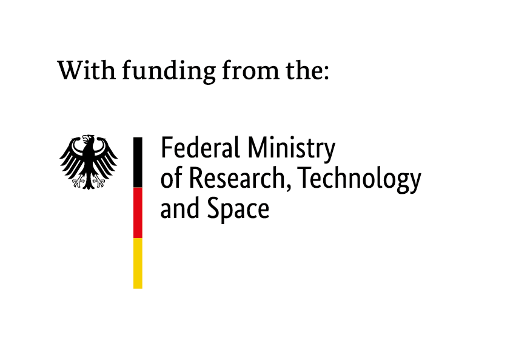
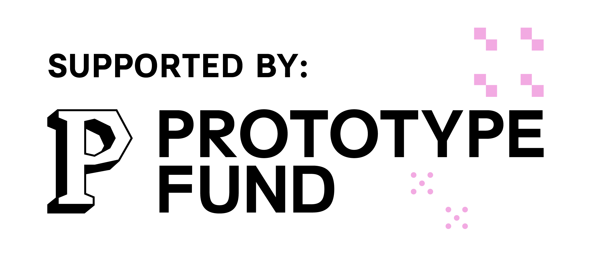

noop is a collection of Obsidian plug-ins.

Thse plug-ins are small software tools meant to support investigators and researchers with building a knowledge base of structured data.

Each plug-in can query [OpenAleph](https://openaleph.org/) instances. Some plug-ins can only pull data from such instances, other push data to them. All plug-ins use the [FollowTheMoney](https://followthemoney.tech/) data schema to represent data.

⚠️ These plug-ins are in an Alpha stage. They _may_ still contain bugs.

The plug-ins are:

- [OpenAleph Search](https://github.com/noop-ptf/OpenAlephSearch)
- [OpenAleph Explore](https://github.com/noop-ptf/OpenAlephExplore)
- [FollowTheMoney Builder](https://github.com/noop-ptf/FollowTheMoneyBuilder)
- [OpenAleph OmniSearch](https://github.com/noop-ptf/OpenAlephOmniSearch)

## Team

The noop team consists of:

- Anna Główczyńska (UI/UX designer)
- Moritz Neeb (developer)
- Sabina-Alexandra Ștefănescu (developer)

This team was active for 6 months, between June and November, 2026.

## Maintenance

As of December 2026, the noop plug-ins are maintained by [The Data and Research Center](https://darc.li/).

## Social media

noop is active on [Mastodon](https://chaos.social/@noop). Video tutorials can be found on the [slow_tech](https://tube.flokinet.is/c/slow_tech/videos) PeerTube channel, maintained by [catileptic](https://chaos.social/@catileptic).

## Sponsor

OpenAleph Explore: an Obsidian Plug-in is funded by the German **Federal Ministry of Research, Technology and Space (BMFTR)** through the **[Prototype Fund](https://prototypefund.de)** under funding code (Förderkennzeichen) **16IS26S15**.

